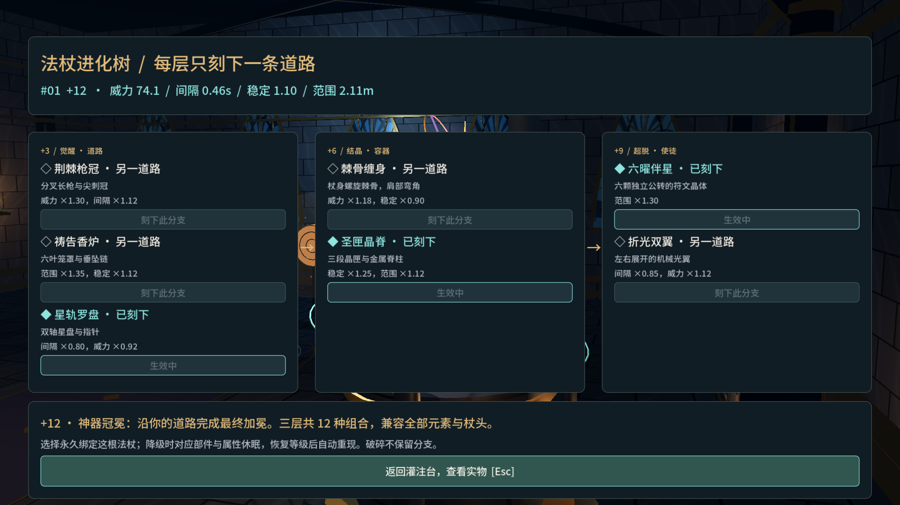
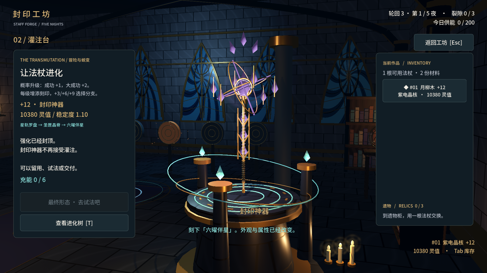

# 铸杖模拟器 · 封印工坊

[简体中文](README.md) · [English](README.en.md) · [安全政策](SECURITY.zh-CN.md)

原创第一人称魔法工坊演示版。组装法杖、冒险灌注、试验火/冰/雷法术，用作品守住五夜封印。

**0.3 更新**：轮回悬疑主线跨至少三次契约，6处可调查线索、4章记忆与2种最终选择。交付指定属性的法杖唤醒记忆，开启新契约保留线索与章节。+3/+6/+9 打开三层进化树，7个节点组成12种搭配，真实改变外观、稳定度与施法。场景增加试剂边桌、手稿、镜片、星盘、黄铜管道与记忆回声。按 J 打开调查手记，T 查看进化树，E 调查实物。

## 直接试玩

从 [Releases](https://github.com/yifanchen12/staff-forge/releases) 下载 StaffForge-Windows-x64.zip，完整解压后运行 StaffForge.exe。StaffForge.exe 与 StaffForge.pck 必须在同一文件夹。无需安装 Godot，也不联网。源码仓库不包含构建产物。

完整操作见 [操作说明](docs/操作说明.md)，测试证据见 [测试记录](docs/测试记录.md)。

## 编辑工程

使用 Godot **4.7.2 标准版**导入 project.godot，按 F5 运行。项目使用 Compatibility / OpenGL 3.3，GDScript，无插件依赖。官方引擎：https://godotengine.org/download/windows/

克隆仓库后使用 Godot 导入 project.godot 即可编辑。也可在 Windows PowerShell 执行 tools/build.ps1；它会将官方便携引擎放到 tools/godot/ 并下载 Windows x64 导出模板。首次构建需要网络，模板下载约1.2GB。引擎、下载缓存和构建产物不提交到 Git。

## 规则与文件

- data/chronicle.json、scripts/chronicle.gd：剧情、线索条件、进化树定义与跨轮回记忆。
- scripts/environmental_story.gd：线索实物、炼金细节、封印痕迹和上次交付回声。
- data/balance.json：概率、价值、贡额、材料、晶核、构型与遗物定义。
- scripts/rules.gd：JSON兼容的 StaffDesign/StaffState/SpellStats/RunState 数据契约和唯一规则实现。
- scripts/staff_visual.gd：尺寸驱动的独立杖身、杖头、晶核、符文节点；替换GLB时保留相同连接位置。
- scripts/gothic_scene.gd：哥特建筑、窗框、烛台、书架和静态装饰合并；不参与经济规则。
- scripts/spells.gd：命中、灼烧、真实减速、雷电连锁与训练靶。
- scripts/workshop.gd：原创场景、移动、工位、控制器、音频和集成验收。
- scripts/ui.gd：中文主菜单、组装、概率、库存、遗物、交付、结局与设置。
- scripts/save_store.gd：输入检查、临时文件替换、有效备份、损坏文件保留与设置。
- assets/used-assets.json、docs/素材来源.md：实际素材与许可。
- assets/stone.gdshader、wood.gdshader、stained_glass.gdshader、crystal.gdshader：原创材质。

轮回记忆与当前契约存在同一个原子保存的文件里。旧版存档载入时补默认记忆/分支字段，不清空作品。剧情与交付共同提交，保存失败整体撤回。

设计参数调整仅影响预览；组装后该作品的组成固定。强化改变属性与价值。未交付的物品跨天保留。三次供能不足失败；活到第五夜结算即完成契约。

## 验证与构建

在项目目录运行：

~~~powershell
./tools/build.ps1 -Verify
~~~

脚本会执行规则、外观、剧情/分支和固定种子平衡测试、导出，然后使用游戏内验收流程检查独立包；不模拟系统鼠标，不接触现有玩家存档。验收使用隔离目录，截图及硬件记录在 build/windows/verification/。

手动规则测试：

~~~powershell
$env:APPDATA = Join-Path (Get-Location) 'artifacts/profile'
./tools/godot/Godot_v4.7.2-stable_win64_console.exe --headless --path . --script tests/test_rules.gd
./tools/godot/Godot_v4.7.2-stable_win64_console.exe --headless --path . --script tests/test_balance.gd
~~~

以上 APPDATA 设置只用于当前测试进程隔离。正常游戏使用用户的 Godot 应用数据目录。

## 安全与第三方许可

漏洞请通过 [私密安全报告](https://github.com/yifanchen12/staff-forge/security/advisories/new) 提交，勿在公开 Issue 中附上令牌、个人存档或未脱敏日志。详见 [中文安全政策](SECURITY.zh-CN.md) / [Security policy](SECURITY.md)。

第三方素材保留各自许可：Kenney 资源为 CC0，Noto Sans SC 字体为 OFL，Godot 引擎及其依赖见 [许可清单](docs/GODOT_LICENSES.txt)。来源与实际用途见 [素材来源](docs/素材来源.md)。第三方许可不会被本项目文档覆盖。

## 已知边界

5天内容已完成。20–30分钟是体验目标，未经过真人计时；熟练操作会更快。当前平衡偏向新玩家，保守策略较容易通关。艺术风格采用原创程序模型与选用的 CC0 资源；精细法杖模型可后续用 Lux3D 替换。本版本未接入 Steam SDK、Steam Cloud 或多人功能。

当前未为本项目原创代码与资源指定开源许可证。上述第三方资源仍按各自许可使用；安全政策不等同于开源许可。
